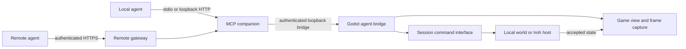

# Agent play through MCP

Status: proposed design, November 5, 2026. No MCP server, bridge, launch flags,
or agent tools described here have been implemented. Existing code references
identify reusable foundations; examples describe the intended interface.

## Purpose

Let an agent play Simulateds while a person watches the running game, or from a
remote connection to an unattended game instance. The agent should understand
the household, choose ordinary activities, build within its budget, and inspect
actual rendered screenshots. It follows the same ownership, routing, spending,
and shared-time rules as a human player.

Start with desktop and Linux service deployments. Keep the Linden Grove game
and its presentation intact. An agent connection is another control surface;
it does not introduce new simulation rules or make rendering authoritative.

## Architecture

Use a companion process written in Python with an official MCP SDK, plus a small
GDScript bridge in the running game. Pin the SDK and supported MCP protocol
versions together and test them against the intended clients. MCP supports
stdio for a client-launched process and Streamable HTTP for a reachable service.
Use the SDK for transport/version compatibility rather than implementing MCP
inside Godot. [MCP architecture](https://modelcontextprotocol.io/docs/learn/architecture),
[transport specification](https://modelcontextprotocol.io/specification/latest/basic/transports).



The companion owns MCP schemas, authorization mapping, response formatting and
transport limits. Godot owns command validation, observations, activity tracking,
camera operations and screenshots. The Iroh host remains the sole authority in
shared play. Screenshot bytes travel over the bridge/MCP connection, not through
the existing small Iroh gameplay packets.

### Existing foundations and required additions

| Area | Existing foundation | Work required |
| --- | --- | --- |
| Commands | `network/session.gd`: `command`, `command_completed`; `game/world.gd`: `apply_command` | Correlated receipts and an agent-facing allowlist |
| Observation | `Session.state`, `World.snapshot`, catalog and activity helpers | Bounded, permission-filtered DTOs with a versioned schema |
| Choices | `game/context_actions.gd`, world `*_option` helpers | Expose valid choices without opening UI panels |
| Completion | Resident task IDs, queue and `game/activity_log.gd` | Map submitted operations to task IDs and retain bounded outcomes |
| Time | Solo pause/1×/2×/4× controls; host simulation tick | Expose existing controls with their current restrictions |
| Rendering | `game/lot_projection.gd` SubViewport and actual game camera | Capture service, metadata, image limits and timeout handling |
| Screenshot examples | `tests/render_game.gd` and native UI suites | Return in-memory images through MCP |
| Lifecycle | Profiles, saves, Iroh join/leave and dedicated server support | Companion supervision, pairing, revocation and service startup |

The current `command_completed` signal contains an intent, success flag and
message, not a unique external operation ID or the IDs of all created tasks.
The multiplayer acknowledgement similarly lacks a complete structured receipt.
This is an explicit implementation gap, not something the MCP adapter can infer
reliably from success text or matching dictionaries.

## Deployment modes

### 1. Attached to the running desktop game

An **Agent access** setting enables the bridge for the current game instance.
It defaults off. Once enabled, the game starts the packaged companion in HTTP
mode, bound to loopback on a dynamically assigned port. The player can copy its
connection details, see connected controllers, and stop access. A saved local
preference may start it on future launches; remote access remains a separate
explicit setting.

For clients that only support stdio, the client starts a lightweight companion
in stdio mode and attaches it to the selected game's bridge. The game cannot
start a stdio server and expect an unrelated client to attach to its standard
streams later. Both entry points use the same tool implementation.

Use an instance ID and a user-private discovery record containing endpoint and
short-lived pairing material. Multiple running games require an explicit
instance selection. Never select the first available world silently. Keep
credentials out of command-line arguments, URLs and diagnostic output. The
game loads no arbitrary executable path supplied by an MCP request.

The adapter is available at the main menu for status only. Gameplay tools become
available after a world is active and a household grant is established. A load,
new world, join or leave invalidates previous operation/view references and
requires a fresh binding. Closing the game stops its companion. A separately
started stdio adapter can remain alive but reports `game_unavailable`.

### 2. A remote agent controls an existing game

Put the companion behind an authenticated HTTPS endpoint. For an initial private
deployment, an SSH tunnel can forward its loopback endpoint while keeping the
bridge private. A hosted deployment can use a reverse proxy or an outbound
tunnel from the game machine, allowing the game to remain behind NAT. A tunnel
provides connectivity; the MCP service still checks identity and permissions.

The remote agent must have a network path to this endpoint. Its own localhost
does not refer to the player's computer. Remote access does not launch or keep
the game running automatically: if the game exits, tools report unavailable.

For general remote-client compatibility, use MCP's HTTP authorization flow with
an OAuth resource server, audience validation, expiry and revocation. Use an
existing authorization provider. Keep those tokens separate from Iroh household
credentials and local bridge pairing secrets. Follow the selected protocol
version's discovery requirements. [MCP authorization](https://modelcontextprotocol.io/specification/latest/basic/authorization).

### 3. Unattended remote play

Run the game and companion under a service supervisor with explicit profile,
save and log locations. For a solo neighborhood, one rendering-enabled game
process can own the simulation and produce screenshots. A dedicated simulation
server is not mandatory.

For shared play, use an ordinary agent client connected through Iroh to the
dedicated host. That client owns the agent's normal household credential and
renders its received state. Provisioning and joining are operator actions;
normal MCP tools cannot supply arbitrary host URLs, filesystem paths or profiles.
A non-rendering client can provide structured play if screenshots are unnecessary.
An unattended client bootstrap is new work; the current `--server` startup is
the dedicated authority, not an agent player.

Agents consume ordinary household/player capacity. The current four-lot model,
reserved host household and duplicate-profile connection rejection still apply.
To control the same household as a person already connected, attach to that
person's game bridge instead of joining a second client with their credential.

## Rendering without a physical display

There are two different meanings of headless:

| Execution environment | Screenshot capability | Design choice |
| --- | --- | --- |
| Normal desktop Godot | Actual rendered viewport | First implementation |
| Godot `--headless` | Dummy renderer; no scene image | Structured state/actions only |
| Linux without a monitor, using a virtual display and OpenGL | Rendering is possible with suitable drivers | Unattended screenshot deployment to validate |
| Custom engine with a native offscreen backend | Depends on the patch/build | Outside the initial implementation |

The project-local Godot 4.7.2 macOS binary was inspected with `--help`; it lists
`"headless" ("dummy")` and no `--offscreen` option. Upstream source also lists
only the dummy renderer for the headless display server and calls
`RasterizerDummy::make_current()` when creating it. A SubViewport or an explicit
draw call does not replace that renderer.
[Headless driver list](https://github.com/godotengine/godot/blob/master/servers/display/display_server_headless.h),
[headless initialization](https://github.com/godotengine/godot/blob/master/servers/display/display_server_headless.cpp).

The practical Linux option is a regular rendering-enabled Godot process using
Xvfb as a virtual X display. Xvfb requires no physical monitor. Mesa LLVMpipe
can supply software rendering where no GPU is available. Since this project
uses OpenGL Compatibility, this is a plausible deployment route; it has not been
run or benchmarked for Simulateds in this design task.
[Xvfb documentation](https://xorg.freedesktop.org/releases/X11R6.8.2/doc/Xvfb.1.html),
[LLVMpipe documentation](https://docs.mesa3d.org/drivers/llvmpipe.html).

An illustrative Linux launch, after installing Xvfb and compatible Mesa/GLX
libraries, is:

```sh
LIBGL_ALWAYS_SOFTWARE=1 xvfb-run -a -s '-screen 0 1280x720x24' \
  python3 tools/godot.py --display-driver x11 \
  --rendering-method gl_compatibility --rendering-driver opengl3 \
  --audio-driver Dummy --resolution 1280x720 \
  -- --save-path=/srv/simulateds/agent-world.json \
  --profile-path=/srv/simulateds/agent-profile.json
```

This illustrates the display setup, not a finished agent-service launcher. It
does not enable MCP or implement unattended menu/join handling. Do not add
`--headless`. Xvfb alone does not guarantee a usable OpenGL context; deployment
must demonstrate successful rendering and image capture. Use a full rendering
export with its art assets, not a server export that strips visual resources.
GPU-backed virtual-display configurations need separate driver validation.

Native offscreen rendering is tracked upstream in
[proposal #5790](https://github.com/godotengine/godot-proposals/issues/5790) and
[draft PR #94530](https://github.com/godotengine/godot/pull/94530). Both were open
at review time. Recheck at implementation, but do not make an unmerged engine
feature a prerequisite. Hidden/minimized desktop windows also need testing:
platform visibility rules can stop frame production.

## Tool contract

Tool names and fields below are proposed. Every call returns the game instance,
world generation, observed tick and relevant revisions. IDs are opaque; the
agent discovers them through observations instead of inventing them. The bridge
schema has its own version, separate from MCP, saves and Iroh's protocol.

| Tool | Inputs and behavior | Permission |
| --- | --- | --- |
| `get_status` | Read readiness, connection, role, household grant, clock and rendering capabilities | Observe |
| `observe` | Read household needs, funds, plans, recent outcomes and selected lot summary; bounded detail/pagination | Observe |
| `inspect_lot` | Read a lot/floor's objects, coordinates, doors, stairs and construction state | Observe |
| `list_actions` | Read choices for a specific resident and target, including unavailable reasons and costs | Observe |
| `act` | Submit one typed activity such as move, interact, visit, cook or tend a garden | Play |
| `edit_plan` | Cancel/reorder an exact activity using existing plan validation | Play |
| `inspect_catalog` | Read searchable kinds, dimensions, prices and build requirements | Observe |
| `preview_build` | Read a placement/removal plan, cost, impact and relevant revision | Observe |
| `build` | Begin, edit, undo, redo, cancel or finish construction through validated commands | Build |
| `get_operation` | Read acceptance and subsequent activity outcomes by operation ID | Observe |
| `wait_for` | Wait for an operation/state condition, bounded by wall-clock timeout | Observe |
| `set_speed` | Existing solo pause/1×/2×/4× controls; reject shared-session requests | Time |
| `set_view` | Select allowed lot/floor, pan, zoom or find an entity; presentation only | Camera |
| `screenshot` | Capture full UI or world viewport at a bounded output size | Capture |

Use discriminated schemas for `act` and `build`, with enumerated action kinds
and their required fields. Do not accept arbitrary command dictionaries,
GDScript, console text, shell commands or filesystem paths. Start with a small
set of everyday actions and grow it by adding schemas and integration tests.
UI-only choices such as opening a meal panel must be identified as navigation;
they must not silently become purchases or cooking commands.

Observation includes units and uncertainty: need values are 0–100; positions
include lot and floor; game-time duration differs from wall-clock timeout;
progress estimates can change because of routing, reservations or interruptions.
Expose public neighborhood information and the granted household's details.
Filter private household records explicitly rather than returning the full
replicated world or its persistence representation.

## Command flow and reliable outcomes

1. The companion validates the schema and authenticated grant. The game bridge
   rechecks its grant, world generation and bounded payload on the main thread.
2. It registers an operation before dispatch so synchronous solo completion
   cannot race the receipt listener. Gameplay goes through `Session.command`.
3. The authority applies normal validation and returns a structured receipt:
   accepted/rejected, reason code/message, operation reference, created task IDs
   and relevant accepted revisions. Save durability is reported separately.
4. A client waits for replicated state reflecting the receipt before claiming
   an observation includes its effects. An acknowledgement can arrive before
   that state. The response may instead say `accepted, state_pending`.
5. `get_operation` and `wait_for` follow task IDs to queued, walking, waiting,
   performing and terminal outcomes. Acceptance does not mean completion.

Add correlation through the session path and host acknowledgement; bump the
Iroh protocol when its wire contract changes and reject incompatible peers.
For immediate construction commands, report completion of the edit separately
from later save success. For batch activities, retain one child outcome per
resident/task. Human actions must not be mistaken for agent operations.

Require a caller-generated idempotency key for mutations. The Godot bridge
retains a bounded ledger keyed by grant, world generation and key, including a
canonical payload hash. A repeat returns the existing operation; a repeat with
different arguments is rejected. Retrying an MCP transport request cannot buy
another sofa or queue a second dinner. An adapter restart can recover from the
same running bridge ledger. A game restart changes the instance/generation, so
old requests are rejected instead of replayed.

The existing Iroh reply cache provides within-connection replay protection; it
does not establish cross-reconnect exactly-once behavior. After ambiguous loss,
return `outcome_unknown` and reconcile against fresh state. Do not automatically
resubmit. If a ledger entry expires, retain an eviction boundary or invalidate
the grant epoch so old keys cannot execute again as new requests.

Keep existing target/revision checks, including meal batches, plan order,
construction drafts and exact artwork identity. Add explicit preconditions where
the tool contract needs them, checked at authority dispatch. A failed preview
or stale target produces a clear rejection and fresh observation; it never picks
a replacement target silently.

The resident activity log currently retains only eight deliberate outcomes.
Use a bounded runtime operation ledger as well, and return `history_expired`
if the available evidence cannot establish an outcome. A vanished task is not
proof of success. No saved operation history is required for the first version.

`wait_for` uses an asynchronous wall-clock deadline (default 10 seconds, maximum
30 seconds). It does not advance the simulation or pause the main loop. A timeout
returns current status; cancelling the wait does not cancel the resident's plan.
Explicit `edit_plan` is required for that. Shared time always follows the host.

## Screenshots and camera control

Full-view capture reads the game root viewport, including HUD and open panels.
World-only capture reads the existing `Neighborhood3D` SubViewport in
`game/lot_projection.gd`; labels drawn outside that viewport are excluded.
Return the choice in metadata so the agent understands what is missing.

The core operation is already used by the game's native visual tests:

```gdscript
# Core capture only. The service also needs readiness, size and timeout checks.
await RenderingServer.frame_post_draw
var image := viewport.get_texture().get_image()
var png_bytes := image.save_png_to_buffer()
```

Waiting for the completed draw avoids a premature viewport read. PNG bytes can
remain in memory and become an MCP image content block, accompanied by structured
metadata. No screenshot file or external image hosting is needed.
[Godot viewport capture](https://docs.godotengine.org/en/stable/classes/class_viewport.html),
[PNG buffer API](https://docs.godotengine.org/en/stable/classes/class_image.html),
[MCP image results](https://github.com/modelcontextprotocol/python-sdk/blob/main/docs/servers/media.md).

Capture metadata includes instance/world generation, frame sequence, rendered
state tick, snapshot age, dimensions, viewed lot/floor, camera framing, UI mode,
day/time, interpolation status and image MIME type. Record the state associated
with the rendered view; do not label a delayed frame with a newer live tick.
Reject a capture if its world changes while it is in flight. An optional
`after_operation` waits for that operation's state to reach presentation first;
it does not imply the resident's activity has finished.

Start at a maximum 1280×720 output, preserving aspect ratio. Bound encoded PNG
size to 4 MiB and wire response size to 6 MiB including base64/metadata. If the
image is too large, downscale or return a clear size error. Allow one capture
in flight per game, at most two per second, with a five-second deadline. These
are initial budgets to measure, not demonstrated performance. Bound allocation
before capture as well as the encoded result.

Never await `frame_post_draw` indefinitely. Check renderer capability first;
return `render_unavailable` for the dummy renderer and `capture_timeout` when
no frame arrives. A disconnected view or an unavailable renderer must not return
a cached image presented as fresh. Camera actions and screenshots do not change
needs, time, paths, saves or commands. Disable audio in unattended deployments.

Initially, camera tools operate the attached game's actual view and visibly
change it. The player can revoke Camera permission separately from Play. An
independent agent camera is a later option that requires another presentation
view reading the same state; it must not create another ticking world. Preserve
the game's existing camera capabilities rather than adding unsupported rotation.

A later unattended optimization can render only when a screenshot is requested,
while simulation/network processing continues. Validate explicit draw behavior
and frame metadata before enabling this; it does not make the dummy renderer
capable of drawing.

## Access, concurrency and disconnects

Bind each grant to one game instance, world generation and household. Separate
Observe, Play, Build, Time, Camera and Capture scopes. Deny write access by default
until the player enables control. One agent controller per household is enough
initially; multiple read-only clients can share bounded observations. The host's
authority must not grant an attached agent control of neighboring households.

The player retains control and can stop agent access immediately. A small status
indicator identifies the active controller and opens access settings. Avoid a
permanent dashboard overlay. Human and agent mutations are serialized through
the same main-thread command path, with revisions preventing stale operations.
Do not disconnect the human's multiplayer session when revoking an agent grant.

Revocation rejects queued, undispatched writes and ends pending captures/waits.
Already accepted resident plans continue under normal game rules unless the
player explicitly cancels them. Removing the agent is not an implicit rollback
of accepted gameplay. The UI reports any unresolved operations.

Construction requires special care: track which controller began a draft and
the revision it last changed. On loss of an attached agent, cancel only an
agent-owned draft that the human has not taken over, through `build_cancel`.
Otherwise leave it with a visible notice for the human. Use a bounded lease for
unattended drafts. For an independently connected agent client, normal Iroh
disconnect rollback and caretaker behavior apply. Never leave a forgotten build
session closed forever or discard a human's later edits.

Use loopback-only bridge sockets with a per-launch random secret and strict
message framing/size checks. Poll bounded input on Godot's main thread; never
block a frame waiting for network I/O. The bridge accepts only allowlisted
methods. HTTPS endpoints validate authentication and Origin/Host as appropriate,
rate-limit callers, and never forward an untrusted household ID as authority.
Logs redact credentials and omit screenshot payloads.

Save/load, new-world creation, developer cheats and application shutdown are
outside the first tool set. Accepted gameplay still follows existing autosave
behavior. No arbitrary file access or direct state editing is exposed. Resident
names, mail and other user-authored strings are observation data, not instructions
for the agent or bridge.

## Suggested implementation layout

| Proposed path | Responsibility |
| --- | --- |
| `tools/mcp/` | Pinned Python package, MCP entry points, schemas and companion tests |
| `network/agent_bridge.gd` | Opt-in listener, authentication, bounded dispatch and lifecycle |
| `game/agent_observation.gd` | Read-only, filtered observation and action descriptions |
| `game/agent_operations.gd` | Grant-scoped correlation, idempotency and outcome ledger |
| `game/agent_capture.gd` | View selection, frame capture, metadata and image bounds |
| `tests/agent_*.gd` | Godot contract, authority and rendering integration checks |

Extend `network/session.gd` only where correlation and receipts require it.
Keep rules in the existing model/helpers and the Iroh transport game-agnostic.
Desktop releases should bundle a platform-specific companion so players do not
need Python installed. Developer builds may use a managed Python environment.
Sign/package the companion with each desktop export and stop it cleanly with
the game. Android packaging and background-service behavior are deferred.

## Delivery and validation

| Stage | Deliverable | Exit evidence |
| --- | --- | --- |
| 1. Local play | Opt-in bridge, stdio companion, observations, a few activities, receipts and waits | Agent completes a meal/rest/care loop through normal commands; rejection and retry tests pass |
| 2. Visual play | Full/world screenshots, view controls, frame metadata and access UI | Agent receives actual images; human watches the same game; dummy-renderer calls fail promptly |
| 3. Construction and multiplayer | Preview/build tools, leases, structured host receipts and ordinary agent client startup | Stale edits, duplicate commands, human takeover and disconnect recovery pass against a real Iroh host |
| 4. Remote deployment | HTTPS authorization, packaged companion, service supervision and virtual-display deployment | Remote client plays and receives screenshots with no physical display; revocation and crash recovery pass |

Test schema bounds, unauthorized/other-household requests, duplicate keys,
payload mismatch, synchronous completion, acknowledgement-before-snapshot,
restart/reconnect ambiguity, expired history, save failures, and world changes
during calls. Test framing and backpressure with a slow/disconnected consumer.
Compare simulation state before and after observation/camera/capture calls in a
controlled paused fixture; those operations must not mutate authoritative state.

Run relevant suites and `python3 tools/check.py` when implementation changes
shared rendering or interaction paths. Inspect native screenshots in the actual
camera at daylight, night, normal and compact windows. Check both full UI and
world-only crops, paused frames, resized windows and hidden-window behavior.
For virtual-display Linux, verify the reported renderer, nonempty representative
images and scene changes across actions, then measure latency, memory and CPU.
Do not infer visual correctness merely from a successful PNG encoding.

Exercise local stdio and Streamable HTTP against actual intended MCP clients,
including image display, protocol compatibility, cancellation and reconnects.
Hosted CI, native local tests, packaged exports and physical-device play remain
separate evidence. Release logs should identify which were actually performed.

Rough implementation effort for one developer is 1–2 days for a basic local
loop, several more days for useful visual/building coverage, and approximately
1–2 weeks total for a hardened remote path. These are planning estimates;
receipt changes, cross-platform packaging, authorization integration and Linux
rendering validation are the largest uncertainties.

## Evidence for this document

Inspected the current session/world interfaces, activity IDs and log limits,
context choices, viewport setup, render tests, networking documentation and
project-local Godot help. Verified upstream headless driver source and checked
the offscreen proposal/PR. The Linux virtual-display launch is a proposed route,
not a test result. No gameplay tests, native render runs, hosted CI, exports or
physical-device checks were performed for this documentation-only change.
